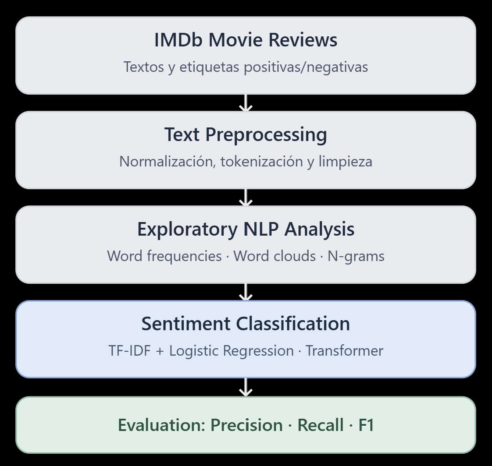
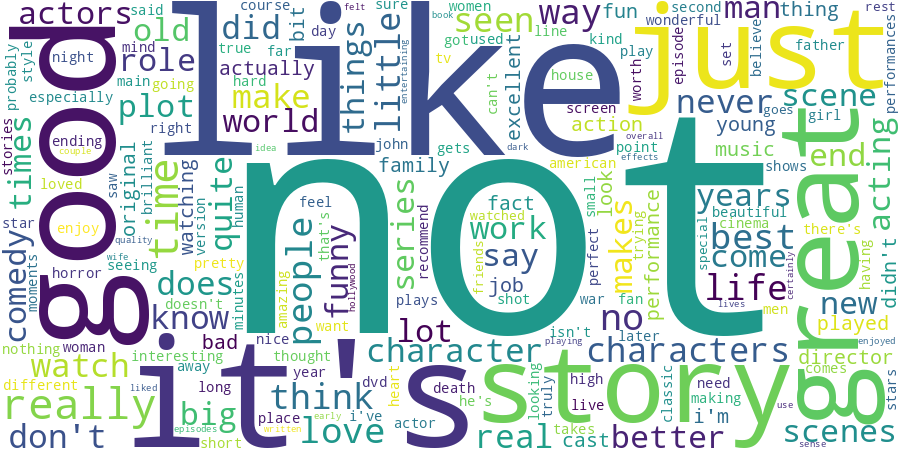
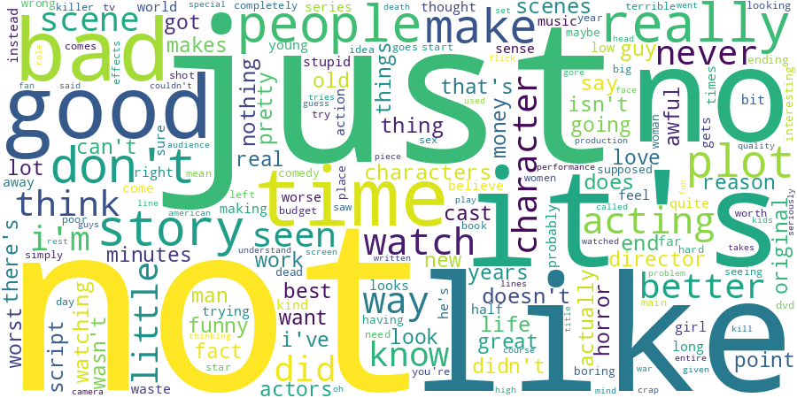
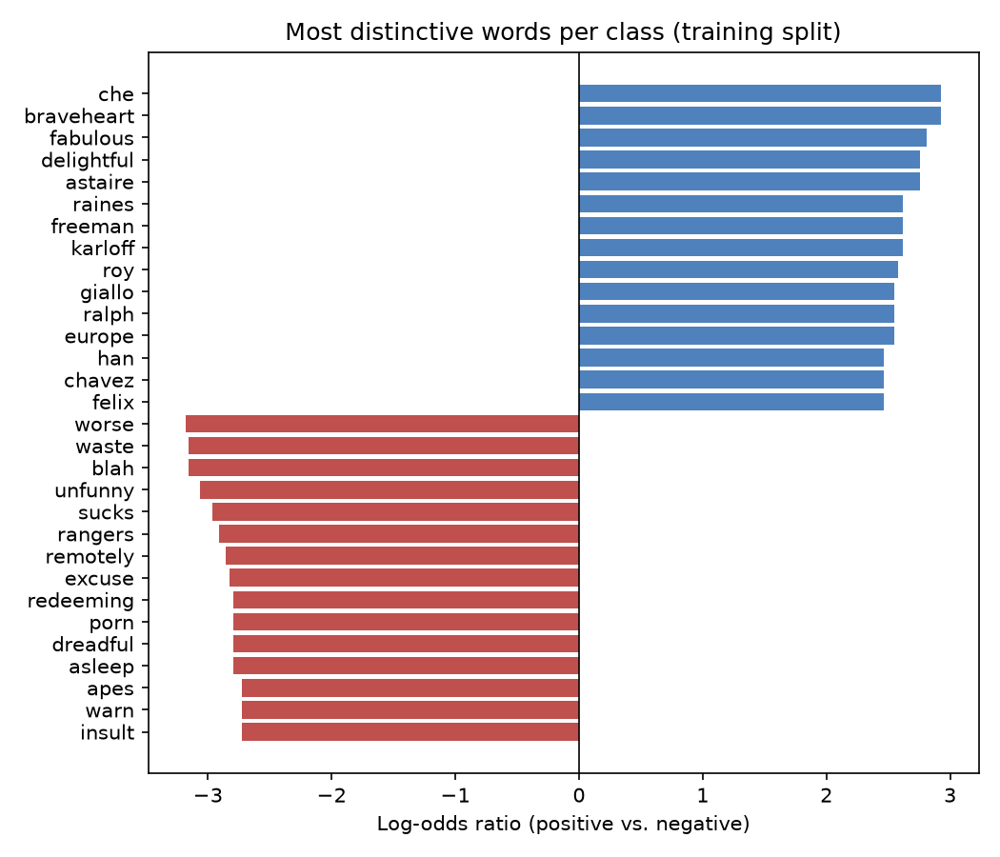
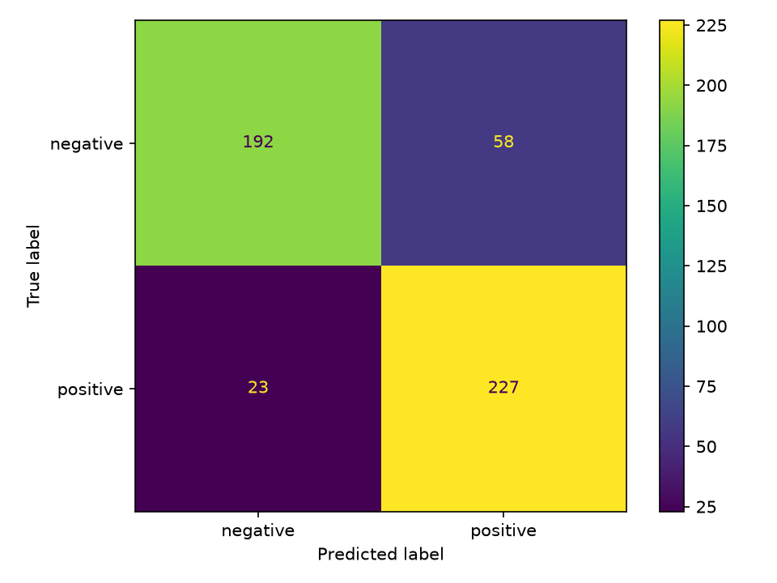

# From Word Frequencies to Transformer-based Sentiment Analysis

A small, reproducible NLP study on **IMDb movie reviews**: explore the language of positive vs. negative reviews, train a classical **TF-IDF + Logistic Regression** baseline, and compare it with an existing **DistilBERT** classifier (fine-tuned by a third party on SST-2; **no training or fine-tuning of a transformer is done here**).



## Run

Python 3.10–3.12 recommended. Internet is needed on the first run to fetch the public IMDb dataset and the pre-trained model. Everything runs on CPU.

```bash
python -m venv .venv
source .venv/bin/activate   # Windows PowerShell: .venv\Scripts\Activate.ps1
pip install -r requirements.txt
python -m pytest -q
python -m src.run --n 400 --transformer-n 40
```

Results go to `outputs/` (ignored by Git): frequency tables, bigram tables, distinctive-word tables, word clouds, confusion matrix, `predictions.csv` and `metrics.json`. Use `--out DIR` to write somewhere else.

The numbers and figures below come from a larger run, which takes about a minute on CPU:

```bash
python -m src.run --n 2000 --transformer-n 250 --out docs/results_n2000
```

## Methodology

- Random seed 42; balanced IMDb sample from the **train** split; stratified 75/25 train/test split (n=2000: 1500 train / 500 test).
- Exploration (frequencies, bigrams, word clouds, log-odds) uses **training texts only**, so nothing is learned from test examples. It strips HTML and stopwords but keeps negations (`not`, `no`, `never`...). The models always receive the **raw** review.
- Classical baseline: TF-IDF unigrams+bigrams (fit on train only, `min_df=2`, 20k features) + Logistic Regression, evaluated on the full held-out test set.
- Transformer: `distilbert/distilbert-base-uncased-finetuned-sst-2-english`, used as-is, on a random subset of the **same held-out** reviews, truncated at the model's maximum length (512 tokens).
- Comparison: the classical model is also scored on exactly those subset reviews. A paired bootstrap (2000 resamples) gives a 95% interval for the macro-F1 difference.

## Results

### 1. Language patterns

Raw frequencies are uninformative: the top tokens are `the`, `a`, `and`, `of`... and `br` (3,462 times in negative and 2,968 in positive reviews). `br` is not language but the `<br />` HTML tag left in the IMDb text; it dominated the first word clouds I generated. After removing HTML and stopwords:

- **Most frequent words are nearly the same in both classes** (`not`, `like`, `just`, `good`, `story`, `time`, `really`...). Frequency alone barely separates sentiment.
- **Negation is the clearest frequency signal**: `not` (1006 vs. 833), `no` (521 vs. 260) and `don't` (295 vs. 178) are more frequent in negative reviews. Bigrams `did not`, `does not`, `it's not`, `i'm not` appear in both classes, which is why negation handling matters for sentiment. Frequent bigrams like `low budget` and `special effects` are negative-leaning; `real life`, `new york` are topical.
- `good` and `bad` are both frequent in both classes (`good` 461 neg / 442 pos), a reminder that polarity words get negated or used in comparisons ("not good", "not as bad as...").
- A smoothed **log-odds ratio** (words with ≥5 occurrences) is far more informative than raw counts: negative `worse`, `waste`, `unfunny`, `sucks`, `dreadful`, `redeeming`; positive `fabulous`, `delightful`.
- It also shows **topic leakage**: many top "positive" words are names or titles (`braveheart`, `astaire`, `freeman`, `karloff`, `che`) and a top "negative" word is `rangers`. With a small sample these reflect which movies happened to be drawn, not sentiment.

| Positive | Negative |
|---|---|
|  |  |



### 2. Classical baseline (TF-IDF + Logistic Regression)

Full test set (500 reviews, 250 per class):

| Class | Precision | Recall | F1 |
|---|---|---|---|
| negative | 0.893 | 0.768 | 0.826 |
| positive | 0.796 | 0.908 | 0.849 |
| macro avg / accuracy | 0.845 / 0.838 | | 0.837 |



The model is biased towards **positive**: 58 negatives were predicted positive (23 positives predicted negative). Likely because with only 1500 training reviews, TF-IDF weights are dominated by topic words and by positive words used inside negative text.

The default quick run (`--n 400`, 300 training reviews) gives macro F1 0.738 on 100 test reviews, so training size matters a lot for this baseline (0.74 → 0.84).

### 3. DistilBERT vs. classical, on the same reviews

Same 250 held-out reviews (120 negative, 130 positive):

| Model | Accuracy | Macro F1 | FP (neg → pos) | FN (pos → neg) |
|---|---|---|---|---|
| TF-IDF + LogReg (1500 train reviews) | 0.864 | 0.862 | 26 | 8 |
| DistilBERT SST-2 (no fine-tuning on IMDb) | 0.916 | 0.916 | 7 | 14 |

Difference in macro F1 (DistilBERT − classical) = +0.054, 95% paired-bootstrap interval **[+0.007, +0.100]**. The advantage is probably real but small, and the interval is wide. With only 40 reviews (`--n 400` run) the same interval is [−0.057, +0.290], too wide to conclude anything.

The two models fail in opposite directions: the classical model over-predicts positive, and DistilBERT over-predicts negative (its errors are mostly positive reviews, 14 of 21).

### 4. Error analysis

Of the 250 reviews: 205 both correct, 24 only the classical model wrong, 11 only DistilBERT wrong, 10 both wrong. Illustrative cases (excerpts of IMDb test-split reviews, row ids refer to `predictions.csv`):

1. **Sarcasm / irony, both wrong (row 1263, negative review).** *"Barbara Streisand directs and stars in this very Jewish story... Don't miss the best of many moments of unintentional humor..."*. Both predict positive: "best", "enthusiastically", "don't miss" are positive on the surface and the criticism is ironic. Neither a bag of n-grams nor a sentence-level model resolves this.
2. **Mixed, hedged reviews, both wrong (rows 1183, 1362, 700; positive reviews).** *"I admit that for the first 20 minutes... I found it pretty boring... However, if you sit through..."* / *"mixed feelings... there is nothing about it that would give you the same sort of feeling"*. The reviewer begins negatively and concludes positively. Both models weigh the many negative words, and these are also long reviews (381–542 words), so the transformer may truncate before the conclusion.
3. **Domain shift / opinion about content, only DistilBERT wrong (row 1622, 822, positive reviews).** In *"The Utopian characters... got tiring, they were so noble as to be unbelievable"* the negative words describe other material (or, in row 822, other people's low ratings) while the review itself is positive. SST-2 contains short sentences, while IMDb reviews mix plot description and criticism over hundreds of words. DistilBERT is also highly confident on its errors (median confidence 0.99), so its score isn't a reliable error flag.
4. **Plot summary with a negative verdict, only classical wrong (rows 1373, 10).** These are long stretches of plot description with an implicit or late negative verdict; a plausible cause is that TF-IDF follows the dominant (neutral or positive-sounding) vocabulary while DistilBERT picks up the verdict (hypothesis, not tested).

Long reviews seem harder for DistilBERT: accuracy 0.94 on reviews up to 250 words vs. 0.86 above (n = 176 and 74, roughly the 512-token limit; the difference is suggestive, not significant).

## Conclusions

- Frequency analysis tells a lot about **data quality** (HTML artifacts, stopwords, topical names) and little about sentiment. Negation and class-discriminative words (log-odds) are more informative than counts.
- A TF-IDF + Logistic Regression baseline reaches ~0.84 macro F1 with 1500 training reviews, runs in seconds, and its features are interpretable. It improves strongly with more data.
- An off-the-shelf DistilBERT, never trained on IMDb, is competitive or slightly better (0.92 vs. 0.86 on the same 250 reviews), yet the gap is small relative to the uncertainty and the models make different errors, which makes combining them an interesting next step.
- Errors on both models are concentrated in sarcasm, hedged/mixed reviews and long reviews, not random noise.

## Limitations

- **Small samples**: 500 test reviews for the classical model and only 250 for the comparison; 40 in the default quick run. Results come from one seed and one split. No cross-validation, no hyperparameter tuning.
- **Not a controlled benchmark**: the classical model is trained on 1500 IMDb reviews, while DistilBERT was trained on SST-2 (a different distribution). A classical model trained on all 25k IMDb reviews would likely be much stronger and change the conclusion.
- Transformer inputs are truncated at 512 tokens, while TF-IDF sees the full review.
- Error analysis is manual and based on a few examples; the causes proposed are hypotheses, not tested.
- English movie reviews only. Labels are binary (neutral not represented). Conclusions don't transfer to other domains or languages (customer service, Spanish, Basque, etc.).
- Log-odds lists on this sample include topical names; word clouds are exploratory and not evidence of classifier quality.
- Learning project, not a production sentiment API.

## Next steps

Train on the full IMDb train set and evaluate on the official test split; add cross-validation and confidence intervals for the classical model; compare with a model trained on the same data (fine-tuned DistilBERT, with GPU); chunk long reviews for the transformer; try an ensemble of both models; optional Gradio demo; repeat in another language.

## Repository layout

```
src/run.py          pipeline: sample, explore, TF-IDF + LogReg, DistilBERT, metrics
src/text_utils.py   tokenization, HTML/stopword cleaning (exploration only), n-grams, log-odds
tests/              unit tests for text utilities
docs/results_n2000/ figures, tables and metrics for the results above
outputs/            default output of a local run (ignored by Git)
```

`predictions.csv` (per-review predictions that include IMDb review text) is generated locally and is not committed.

## Source

IMDb dataset available through Hugging Face `stanfordnlp/imdb`; pre-trained transformer `distilbert/distilbert-base-uncased-finetuned-sst-2-english`.
